<div align="center">

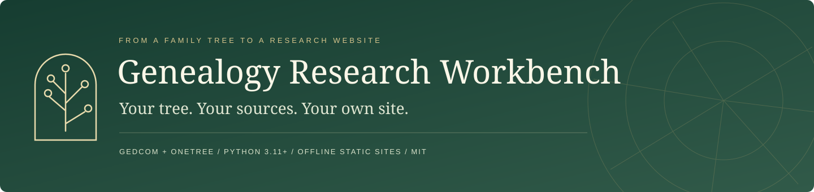

**Your family tree, the evidence behind it, and a website of your own.**

[](https://github.com/glasgowm148/genealogy-research-workbench/actions/workflows/ci.yml) · [Releases](https://github.com/glasgowm148/genealogy-research-workbench/releases) · [MIT](LICENSE)

[Get started](#get-started) · [Your first site](docs/first-site.md) · [Take a look](#what-you-can-build) · [Import formats](docs/imports.md) · [Privacy](docs/privacy.md) · [Developer guide](docs/development.md)

</div>

Genealogy Research Workbench turns a GEDCOM or WikiTree OneTree export into a searchable family-history website, with a workspace for developing the research behind the tree. It grew out of the [Glasgow One Name Study](https://glasgow.phenotype.dev/) and is reusable for your own family, surname or historical research project.

- **Explore your tree:** searchable people, family dossiers, interactive trees, branches, timelines and places.
- **Show your reasoning:** connect sources and citations to claims, competing hypotheses, open questions, written studies and dated findings. Keep imported assertions distinct from assessed conclusions.
- **Keep control:** work locally, review what becomes public, and host the generated static site wherever you choose.

### A companion to WikiTree

OneTree imports retain WikiTree identifiers, so your local research stays connected to the profiles it concerns. Use the workbench to investigate questions and prepare sourced updates to make manually on WikiTree. You can also link a published research study from a WikiTree profile. The toolkit does not automatically synchronize with or write back to WikiTree.

Imports and builds run on your computer with **no runtime dependencies or network requests**. Research is kept in one SQLite database per project (Python's standard library), with every change recorded: who made it, with which tool, and why. The output is ordinary HTML, CSS, JavaScript and data files; publishing is your choice.

## What you can build

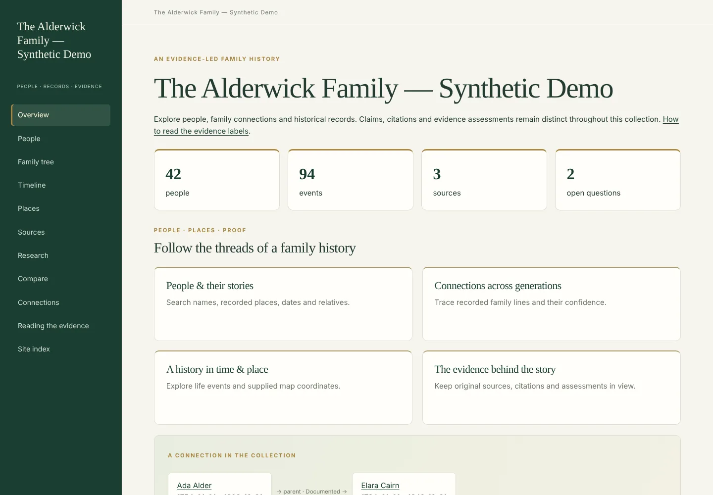

| Find a person | Read a dossier |
| --- | --- |
| 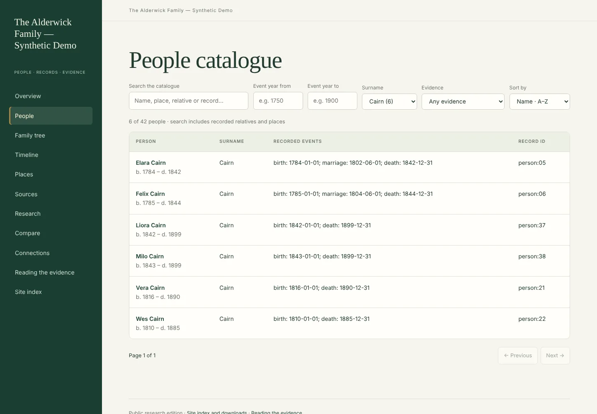 | 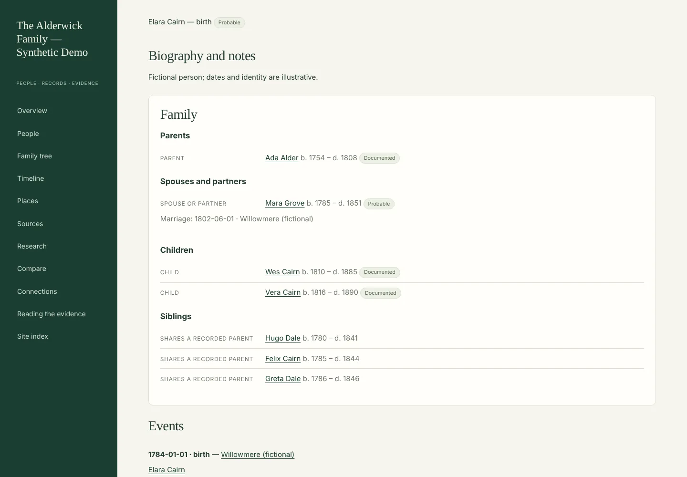 |
| A research table of everyone — dates, places, spouse, father and mother, each link with its evidence badge — behind seven menus: Name, Relatives, Dates, Places, Evidence, Filters and your tree. | Vitals, the latest finding and what to do next, then names, family with the reason for every link, events, studies and research. |
| 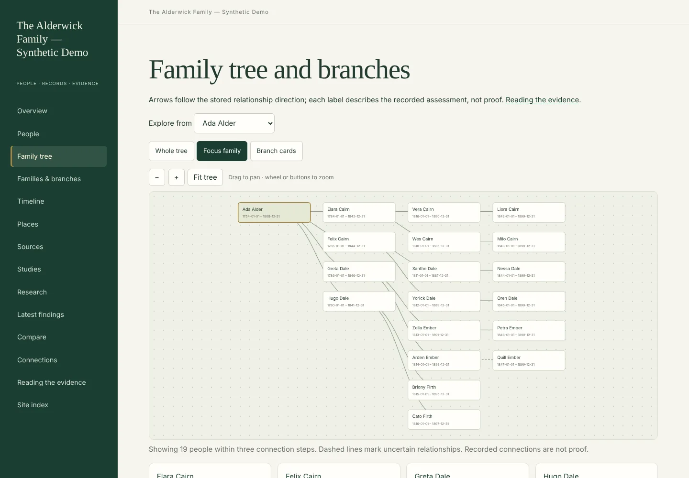 | 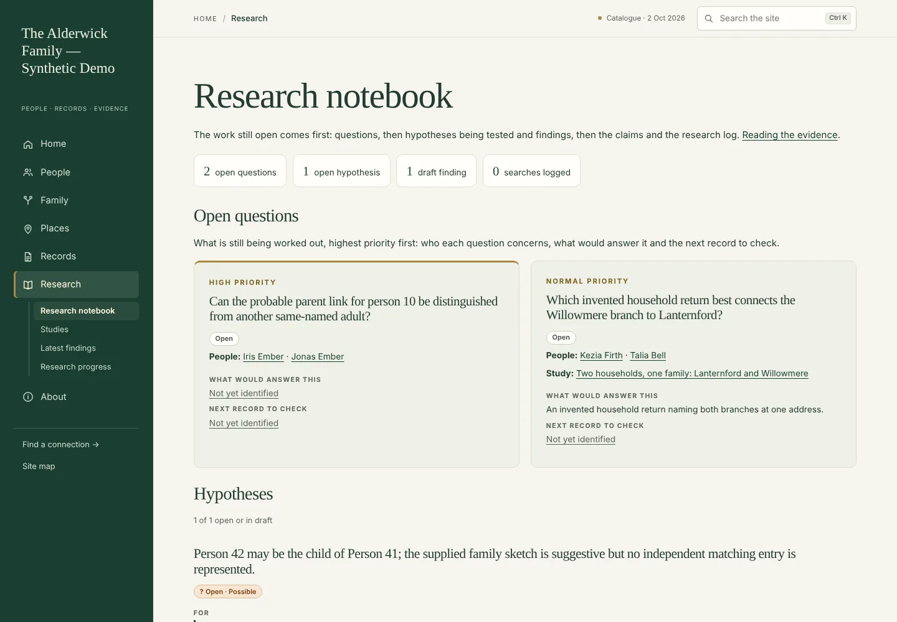 |
| A whole-tree atlas, whole tree, family focus, branch cards, hourglass, family sun and lanes. Uncertain links stay visible. | Open questions first, with what would answer them; then hypotheses, findings, claims and every search made, including the ones that found nothing. |

<details>
<summary><b>More views: studies, findings, records, branches, places, evidence, statistics and the data</b></summary>

| Write it up | Follow the evidence |
| --- | --- |
| 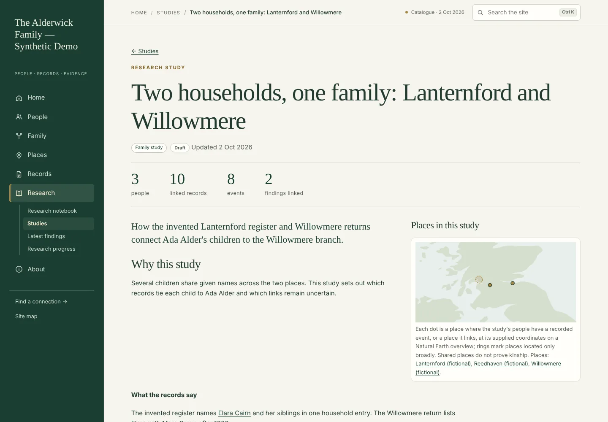 | 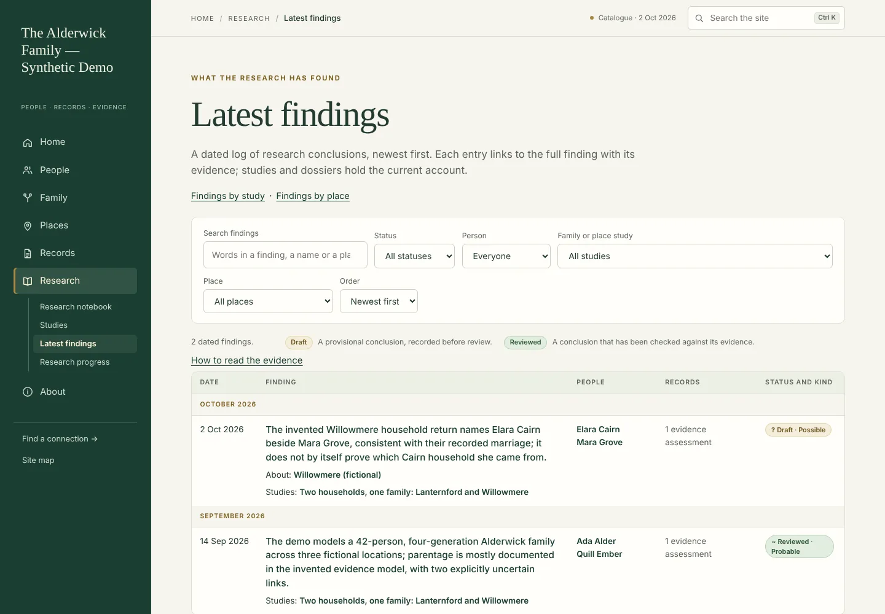 |
| Why a question was investigated, what the records show, what it does not establish, and who and where it concerns. | Every dated conclusion, filterable by words, type, status, person, study and place; an Atom feed when a site has an address. |
| 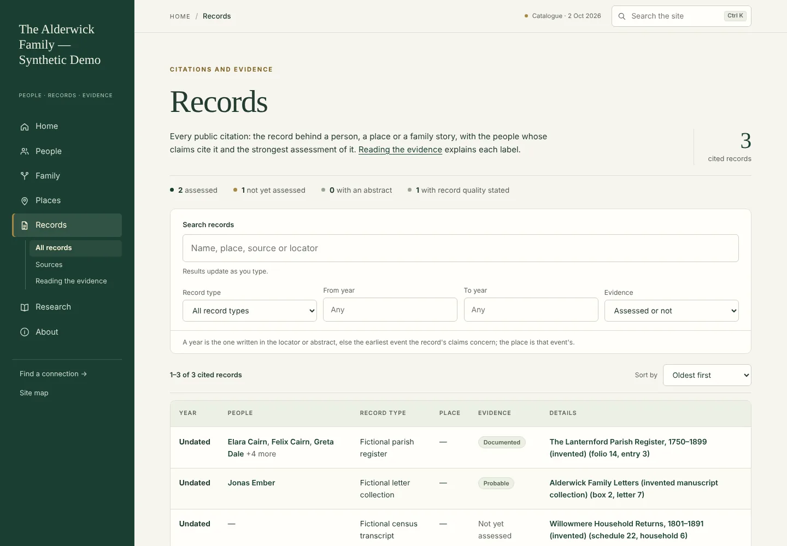 | 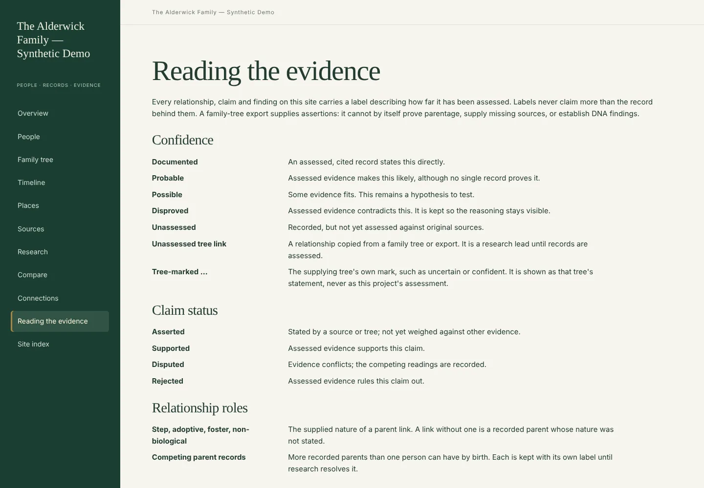 |
| Browse every cited record; search, filter by type, year and evidence, and sort. | One badge system across the site: confidence, grade, status, record quality and finding type, each linked to its meaning. |
| 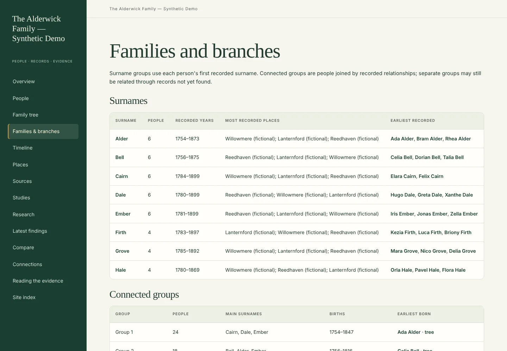 | 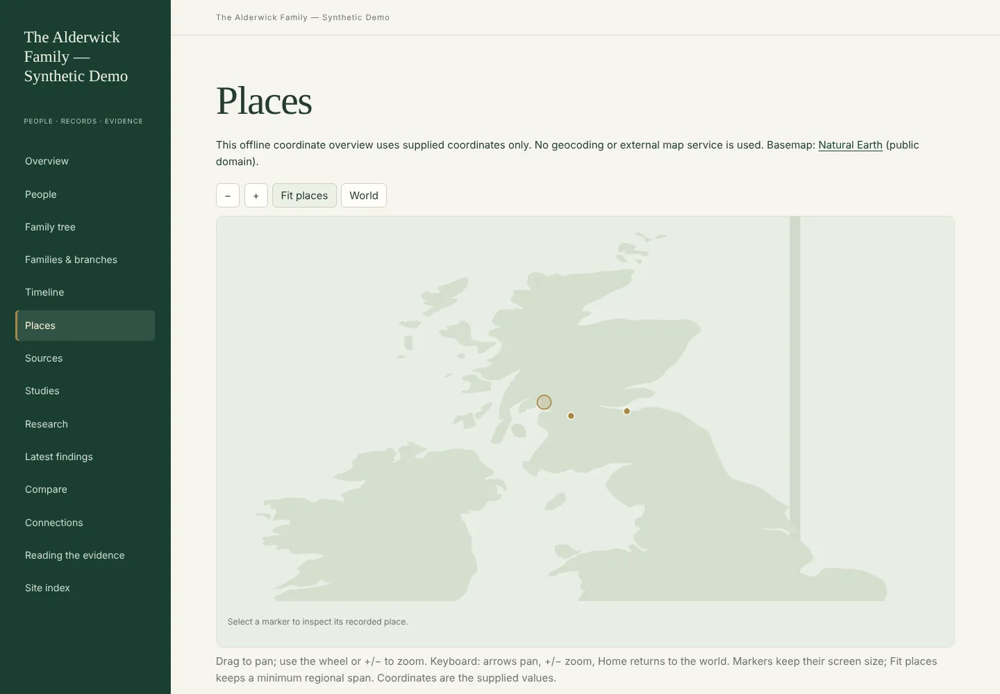 |
| Surname groups (spelling variants folded together) and connected families. | Place cards and pages, grouped by the region you file them under, with a map wherever coordinates are supplied. No tiles, no network. |
| 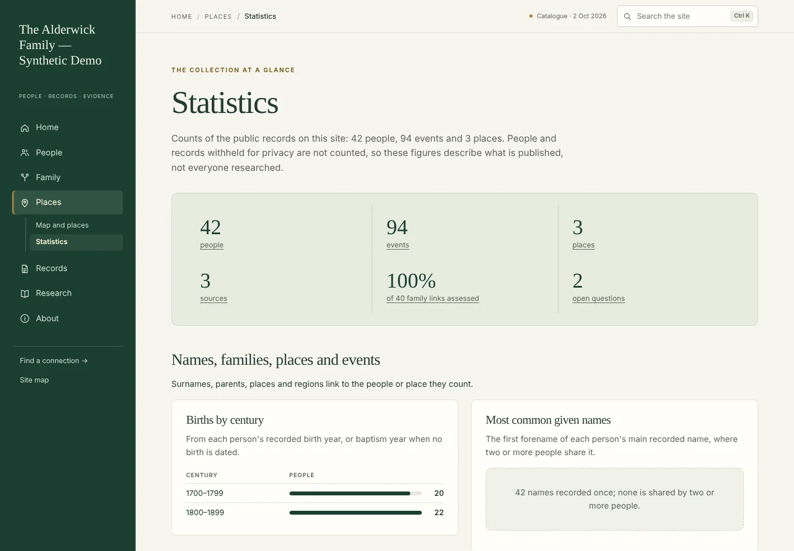 | 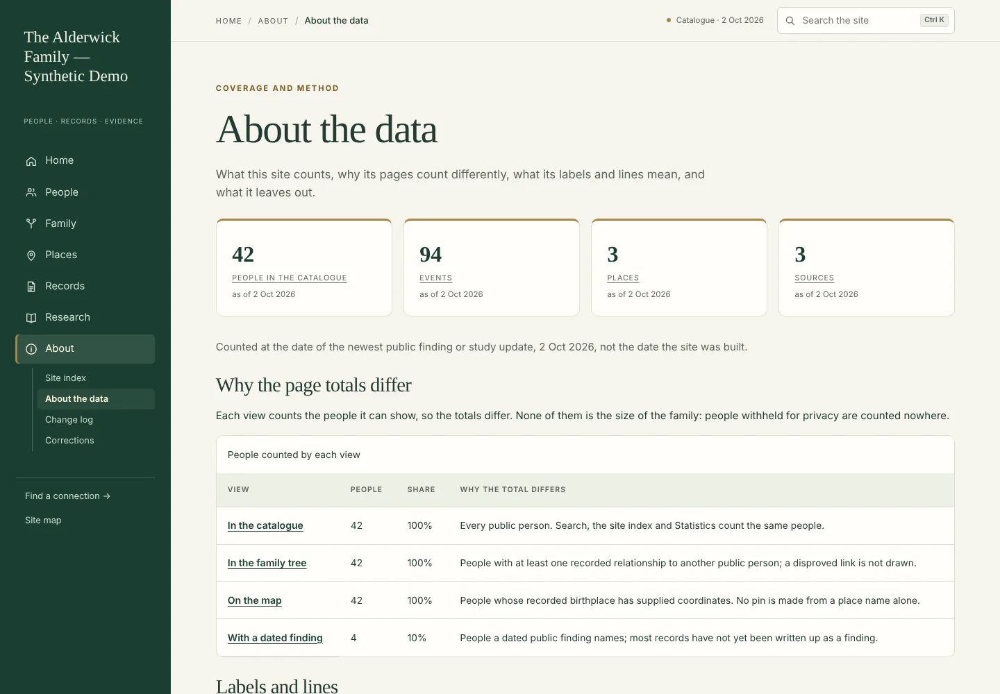 |
| What is in the collection and how well it is evidenced. | How the figures were gathered and graded, what every label means, and a dated change log of what moved. |

</details>

The screenshots use the [fully fictional Alderwick demo](examples/demo/README.md), captured on 22 October 2026 at 1440 × 1000 with `python tools/readme_screenshots.py`. They contain no real family data. Every page is readable with JavaScript disabled; the menus, search, maps and trees are local JavaScript with no network requests.

### What a site contains

| Area | Pages |
| --- | --- |
| People | Find a person (the catalogue), person dossiers, families and branches, possible duplicates (optional) |
| Family | Family tree (six views), timeline, find a connection, compare two people |
| Places | Map and place list, one page per place, statistics |
| Records | All cited records, sources and citations, reading the evidence |
| Research | Research notebook, studies, latest findings, research progress |
| About | Site index and downloads (JSON, CSV, GeoJSON, GEDCOM, feeds), about the data, change log, corrections |

## Get started

You need **Python 3.11 or later** and Git. No database server, account or API key is required: the research database is an ordinary SQLite file that Python already supports. Install the toolkit from GitHub:

```sh
python3 -m venv .venv
source .venv/bin/activate
python -m pip install genealogy-research-workbench
```

To try unreleased changes, install from GitHub instead: `python -m pip install "git+https://github.com/glasgowm148/genealogy-research-workbench@main"`.

On Windows, activate with `.venv\Scripts\activate` instead. To work on the toolkit itself, or to run the fictional demo, clone this repository and see [installation](docs/development.md#install-and-test). New here? [Your first site](docs/first-site.md) walks through every step.

### Choose a file in your browser

```sh
genealogy --project my-workspace serve
```

Open the printed **http://127.0.0.1:8000/** URL. Choose your `.ged`, `.gedcom`, GEDCOM 7 `.gdz` or OneTree `.json` file, enter a public project title, and create a preview. The file is sent only to the local server on your computer.

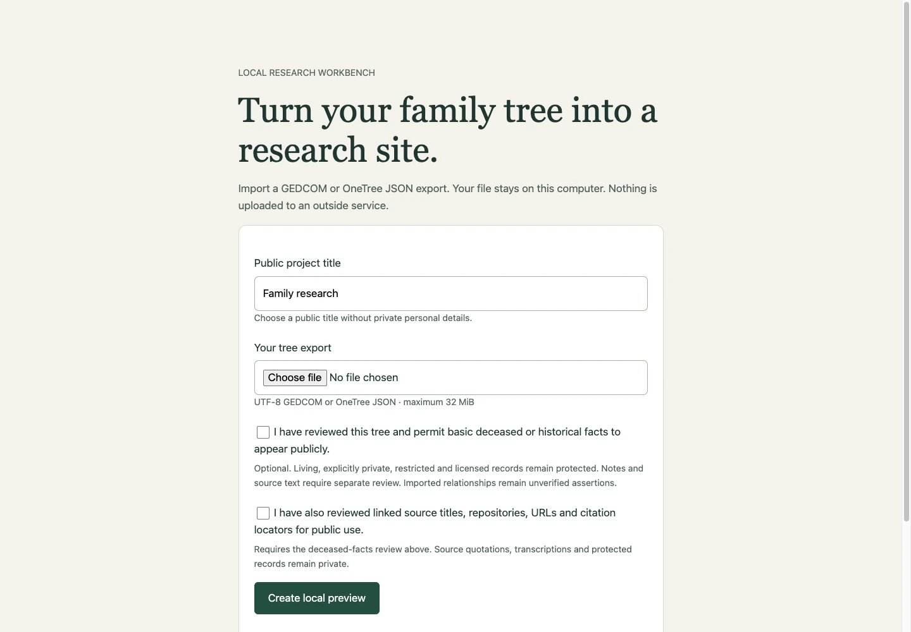

Publication controls are explicit: permit reviewed basic deceased-person facts, and optionally reviewed source bibliography and citation locators. Living, unknown-status, explicitly private, restricted, and licensed material stays protected. Imported notes, quotations, and transcriptions are retained privately. See [the exact publication rules](docs/privacy.md).

The upload screen saves each import as its own project under `my-workspace/private/previews/`. Its preview link works while that server runs. Keep the saved project to continue researching or build its `dist/` folder for hosting. This command is a local desktop tool, not a public upload service.

### Or use the command line

```sh
genealogy init my-family --name "Our family history"
genealogy --project my-family import /path/to/family.ged \
  --publish-deceased --publish-reviewed-sources
genealogy --project my-family validate
genealogy --project my-family build
python -m http.server 8000 --bind 127.0.0.1 --directory my-family/dist
```

Open [localhost:8000](http://localhost:8000/). For OneTree, use the same command with a JSON export:

```sh
genealogy --project my-family import /path/to/one-tree.json --publish-deceased
```

Got a newer export of the same tree? `import FILE --update` refreshes the imported records and keeps everything you added: findings, questions, sources, notes and assessments. People are matched across exports by their durable identifiers (WikiTree ids, GEDCOM UIDs), and values that changed are listed for review rather than overwritten silently. Nothing is deleted, so there is no "replace" mode. An identical import with the same review options does nothing. Omitting publication options keeps the imported records private, so the public site can be empty. Your original file is kept privately, by hash, and never modified.

| Supported input | Details |
| --- | --- |
| GEDCOM 5.5, 5.5.1 and 7 (`.ged`, `.gedcom`) | Declared UTF-8, UTF-16, ANSI, ANSEL, ASCII and Mac encodings; names with surname parts; about 40 event types; parent roles (step, adopted, foster); identifiers; sources with author, publication and repository; citations with locators; supplied coordinates |
| GEDCOM 7 archive (`.gdz`) | The GEDCOM inside is imported as above; media files stay in the private copy and are not published |
| WikiTree OneTree JSON (`.json`) | Profiles, parents, spouses and marriages; WikiTree `1850-00-00` dates with guess/before/after qualifiers; the tree's own parent marks; privacy levels |

Everything the importer does not interpret is counted in the import report and kept in the private original. See [import formats](docs/imports.md).

### Try it before importing your family

From the toolkit checkout (the demo is stored in the earlier JSON-case format, so this also shows the upgrade):

```sh
cp -R examples/demo /tmp/alderwick
genealogy --project /tmp/alderwick upgrade
genealogy --project /tmp/alderwick build
python -m http.server 8000 --bind 127.0.0.1 --directory /tmp/alderwick/dist
```

The demo has 42 invented people, four generations, sources, uncertainty (including one person with two candidate fathers and a reassessment still to make on the tree), three invented DNA branches, and research questions. The [matching GEDCOM and OneTree files](examples/demo/input/) let you exercise the complete import workflow.

## What comes from your export—and what you add

| From a GEDCOM or OneTree export | With additional research |
| --- | --- |
| People, recorded names, supported event fields, and family links | Evidence-based identity and relationship assessments, each with its reason and limits |
| Find a person, dossiers, seven tree views, branch cards, surname groups and statistics | Written studies, a dated findings log with what each finding changed, and a research log of searches made |
| Timelines, place cards and pages; maps when coordinates are supplied | Reviewed coordinates with their precision, the regions you file places under, and archive research |
| Comparison and shortest recorded connection paths, with an evidence threshold | Resolution of namesakes and competing hypotheses, with the points for and against |
| GEDCOM bibliography and citation locators after explicit review | Record quality, abstracts, source transcriptions and record-by-record analysis |
| Step/adoptive roles and the tree's own uncertainty marks, shown as such | Assessed confidence for each relationship, in your own grades if you define them |
| Public JSON, CSV, GeoJSON and a filtered GEDCOM download; a change log and progress history | Open questions with what would answer them and the next record to check; corrections from readers |

An export supplies recorded tree assertions. It cannot manufacture missing sources, prove parentage, recover photographs, or infer DNA results. OneTree biography text is retained privately; arbitrary WikiTree markup is not converted into independently verified citations. [Supported formats and limitations](docs/imports.md) describe exactly what is imported.

The reusable package includes the research model, adapters, local upload workflow and general website. The Glasgow study’s historical research, surname rules, private records, custom editorial pages and DNA studies remain in that project.

## Continue the research

Research lives in one SQLite database per project (`private/research.sqlite`). Every command below writes through the same audited services; nothing edits JSON files.

```sh
genealogy --project my-family source add "Parish register of St Ann" --repository "County Record Office"
genealogy --project my-family record add baptism --title "Baptism of Ada, 1801" --source SOURCE-ID --date "3 May 1801"
genealogy --project my-family citation add --source SOURCE-ID --record RECORD-ID --locator "folio 12"
genealogy --project my-family mention add RECORD-ID "Ada" --role child
genealogy --project my-family identify MENTION-ID PERSON-ID --status possible     # candidates can compete
genealogy --project my-family relationship add CHILD-ID father FATHER-ID
genealogy --project my-family assess CLAIM-ID --status probable --estimate 70 --reasoning "Baptism names him."
genealogy --project my-family assess CLAIM-ID --expected-revision 1 --status proved   # later revisions keep history
genealogy --project my-family history CLAIM-ID
genealogy --project my-family question add "Who were Ada's parents?" --about PERSON-ID
genealogy --project my-family search add s-1 "St Ann burials 1820-1840" --result "nothing found" --for PERSON-ID
genealogy --project my-family review list          # conclusions whose premises changed
genealogy --project my-family publication          # what the public site includes and omits
genealogy --project my-family gedcom export family.ged --version 7.0     # or 5.5.1; with a loss report
genealogy --project my-family native export private/exports/full.json   # complete, versioned, private
genealogy --project my-family backup create
genealogy backup restore private/backups/<stamp> ~/restored-family
```

Changing an existing record or assessment needs the revision you read (`--expected-revision N`); if someone changed it since, the command refuses and shows the current version, so two people can't silently overwrite each other. Anything an import couldn't interpret, or two exports disagree on, is kept as an item for review: `genealogy legacy list` shows them and `genealogy legacy resolve ID --resolution "why" --expected-revision N` records the decision. Items are never deleted.

Any command that takes an id also accepts `SYSTEM:VALUE`, such as `wikitree:Ada-12`. Bulk or agent-written changes go through a reviewable [proposal](docs/database.md#writing-safely) that is re-checked against the current revisions before it is applied. [The research database](docs/database.md) explains the model; [backup and upgrades](docs/backup.md) covers restoration, upgrades and moving an earlier JSON-case project in with `genealogy upgrade`.

## A portable project

```text
my-family/
├── genealogy.toml          Project name, privacy, storage, views and presentation settings (yours)
├── genealogy.local.toml    Optional machine-specific file locations (keep out of version control)
├── private/research.sqlite The one authoritative research database (private)
├── private/assets/         Original imports, captures and prose, by content hash (private)
├── private/backups/        Verified backups (private)
├── private/exports/        Native exports and build reports (private)
└── dist/                   Generated, privacy-filtered website and downloads
```

All generated site links are relative, so the site works under a subdirectory and can be hosted on an ordinary static server. It needs no external scripts, maps, fonts, or analytics. Each build renders into a fresh staging folder, checks it for withheld material and only then replaces the previous build; a folder the workbench did not build is never replaced.

## Documentation and development

| Guide | Contents |
| --- | --- |
| [Your first site](docs/first-site.md) | Export → import → review → research → update → publish, step by step |
| [Import formats](docs/imports.md) | GEDCOM subset, OneTree shapes, warnings, encoding, and limitations |
| [Privacy and publication](docs/privacy.md) | Review options, withheld content, private bundles, and local uploads |
| [The research database](docs/database.md) | What is authoritative, the model, safe writing, publication, builds and every command |
| [Backup, restore and upgrades](docs/backup.md) | Backups, native exports, schema upgrades and moving JSON cases into the database |
| [GEDCOM](docs/gedcom.md) | GEDCOM 7 / 5.5.1 import and export mappings, the extension and the loss report |
| [Research recipes](docs/research.md) | Citations, confidence, studies, place precision and public review |
| [Glasgow feature parity](docs/parity.md) | Shared features, recent ports and project-specific research |
| [Build and deployment](docs/deployment.md) | Branding, generated routes, static hosting, and rebuilds |
| [Developer guide](docs/development.md) | Tests, package builds, adapters, and release checklist |
| [Changelog](CHANGELOG.md) | Changes in the reusable package |

To make the site read as your project's, set the surname, the online tree you work from, spelling variants, your own confidence grades, a contact address for corrections and a base address for feeds in `genealogy.toml`; [build and deployment](docs/deployment.md) lists every setting.

```sh
python -m pip install -e '.[dev]'
make check
python -m build
```

Browser checks are optional: install `.[browser]`, run `python -m playwright install chromium`, then `make browser-check`. The same extras let `python tools/readme_screenshots.py` refresh the screenshots above from the demo. Tests and demos use fictional records only.

Licensed under [MIT](LICENSE). The software license does not grant rights to records, photographs, or other material you import.
