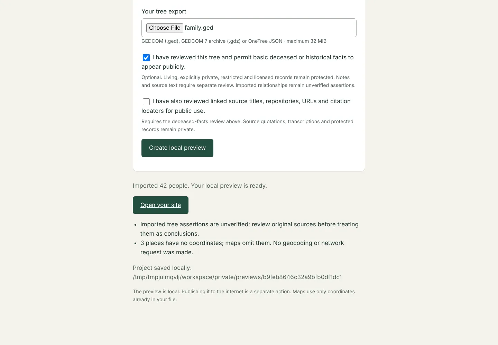

# Your first site: from a tree export to a published website

This walkthrough takes one family-tree export all the way to a hosted site. It takes about fifteen minutes. Nothing leaves your computer until you choose to publish the finished folder.

## 1. Export your tree

From your family-tree program, export one of these:

- **GEDCOM** (`.ged`) from Family Tree Maker, RootsMagic, Gramps, Ancestry, MyHeritage, WikiTree and others. UTF-8 is best, but the declared ANSI, ANSEL, UTF-16 and Mac encodings are read too.
- A **GEDCOM 7 archive** (`.gdz`). Its media files stay private.
- A **WikiTree OneTree JSON** export (`.json`).

Keep the export somewhere private. The toolkit keeps its own private copy and never changes yours.

## 2. Install the toolkit

You need Python 3.11 or later.

```sh
python3 -m venv ~/genealogy-env
source ~/genealogy-env/bin/activate
python -m pip install "git+https://github.com/glasgowm148/genealogy-research-workbench@main"
```

(PyPI's 0.6.0 predates the research database; install from GitHub until a newer release is published.)

On Windows, activate with `%USERPROFILE%\genealogy-env\Scripts\activate`. The import package is called `genealogy`. An unrelated PyPI project named `genealogy` uses the same module name, so don't install both in one environment.

## 3. Import in your browser

```sh
genealogy --project my-workspace serve
```

Open the printed `http://127.0.0.1:8000/` address. Then:

1. Give the site a public title, with no private details in it.
2. Choose your export.
3. Decide what may be public:
   - **Basic deceased or historical facts.** Living people, people whose status is unknown, and private, restricted or licensed records stay protected either way.
   - **Reviewed source titles and citation locators.** Quotations and transcriptions stay private.
4. Select **Create local preview**.



Read the notes under the result. They say:

- how many people were imported;
- what could not be interpreted, such as unsupported tags or relatives outside the export;
- that no geocoding was done.

**Open your site** shows the preview. The project is saved under `my-workspace/private/previews/`.

Prefer the command line? The same import is:

```sh
genealogy init my-family --name "Our family history"
genealogy --project my-family import ~/exports/family.ged --publish-deceased --publish-reviewed-sources
```

## 4. Review what is public

Build the site and read it as a stranger would:

```sh
genealogy --project my-family build
python -m http.server 8000 --bind 127.0.0.1 --directory my-family/dist
```

Check these pages:

- **People:** one dossier per public person, with family, events, sources and labels such as "Unassessed tree link". **Reading the evidence** explains every label.
- **Families & branches:** surname groups and connected families. If one family is split across spellings (Fable, Fabel), [group the spellings](research.md#group-spellings-of-a-surname) in `genealogy.toml`.
- **Places:** countries and regions, and a map of the coordinates your export supplied.
- **Site index and downloads:** the public JSON, CSV, GeoJSON and GEDCOM files contain only what the pages show.

If someone should not be public, mark them private in your tree program and import again (step 6). Then run the link check before publishing:

```sh
genealogy --project my-family check-links
```

## 5. Add your research

An export holds tree assertions. Your research turns them into an evidence-led site:

Research refers to records by id. Imported ids follow the export's own: GEDCOM person `@I12@` becomes `gedcom:person:I12`. List them with:

```sh
genealogy --project my-family record list --kind Person
```

- **Findings**, dated so they appear in **Latest findings**:

  ```sh
  genealogy --project my-family finding add finding:census-1851 "The 1851 census names the household" --related gedcom:person:I12 --recorded-on 2026-10-20 --status reviewed --sensitivity public
  ```

- **Studies:** a written account with rationale, prose that links to records, and a conclusion. See [Write a study](research.md#write-a-study).
- **Assessments:** confidence and, if you use them, percentage estimates for relationships. See [Assess a relationship](research.md#assess-a-relationship).

## 6. Update from a newer export

When your tree changes, export it again and import with `--update`:

```sh
genealogy --project my-family import ~/exports/family-2027.ged --update --publish-deceased --publish-reviewed-sources
```

This adds what is new and keeps everything already there, including your findings, studies, questions and assessments. Where the new export disagrees with a value already loaded, both are kept and the difference is listed for you to decide: `genealogy --project my-family legacy list`. Back up first with `genealogy --project my-family backup create` if you like a restore point.

## 7. Publish

Upload only the contents of `my-family/dist/` to any static host: GitHub Pages, Netlify, Cloudflare Pages or your own web server. To also produce an XML sitemap, canonical links and an Atom feed of your latest findings, first set your address in `genealogy.toml` and rebuild:

```toml
[site]
base_url = "https://example.org/family/"
```

To invite corrections, add `contact_email = "corrections@example.org"` (or an https `contact_url`) under `[site]`. The site then gains a Corrections page and a **Suggest a correction** link on every person's page. See [Build and deployment](deployment.md#configure-your-project).

Replace the whole folder on every deployment, so that withdrawn pages disappear. Never upload the project folder itself: `cases/` and `private/` hold your private research and the original export. See [Build and deployment](deployment.md) for details.
